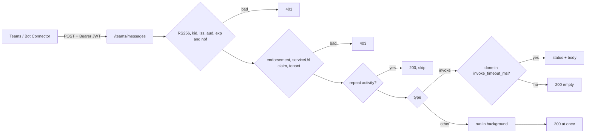

# autumn-plugin-teams

Microsoft Teams plugin for [autumn-web](https://autumn-web.app) 0.8.

- A Bot Framework route that checks the Connector JWT before it reads the body.
- Typed handlers by command, activity type, event name, invoke name, or
  Adaptive Card verb.
- A Connector REST client with an app token, safe retry rules, and a
  `serviceUrl` host allowlist. Proactive messages.
- Health indicator, Prometheus metrics, and drain on shutdown.
- Test helpers: a test token authority and a fake transport.

## Install

```toml
[dependencies]
autumn-plugin-teams = "0.1"
```

```rust,ignore
use autumn_plugin_teams::activity::{Activity, InvokeResponse};
use autumn_plugin_teams::{HandlerResult, TeamsContext, TeamsPlugin};

async fn deploy(ctx: TeamsContext, a: Activity) -> HandlerResult<()> {
    let (_, env) = a.command().unwrap_or_default();
    ctx.reply(Activity::message(format!("Deploying {env}"))).await?;
    Ok(())
}

async fn approve(_ctx: TeamsContext, a: Activity) -> HandlerResult<InvokeResponse> {
    let verb = a.card_action().map(|c| c.verb).unwrap_or_default();
    Ok(InvokeResponse::card_message(format!("{verb}: done")))
}

#[autumn_web::main]
async fn main() {
    autumn_web::app()
        .plugin(
            TeamsPlugin::new()
                .command("deploy", deploy)
                .card_action("approve", approve),
        )
        .run()
        .await;
}
```

Set two env vars: `TEAMS_APP_ID` and `TEAMS_APP_PASSWORD`. For a
single-tenant bot, also set `TEAMS_TENANT_ID`. See `examples/app.rs` for
cards, a welcome text, and a proactive message.

## Azure Bot setup

Set the **Messaging endpoint** of the Azure Bot to
`https://<host>/teams/messages`. `/teams` is the default base path.

To change the base path, use `TeamsPlugin::new().base_path("/bots/teams")`.
This is a builder setting, because autumn mounts routes before it loads
config.

### CSRF

The Connector sends no CSRF token. The JWT check protects the route. If CSRF
protection is on, exempt the base path:

```toml
[security.csrf]
exempt_paths = ["/teams"]
```

The plugin cannot add this exemption. If it is missing, the app stops at
startup. The error message shows the fix. CAPTCHA checks only form bodies.
The Connector sends JSON, so CAPTCHA needs no change.

### Process roles

The route serves only in the `web` and combined roles. A `worker` process
needs no app ID check and no exemption. It still gets the client, so a
`#[job]` can send proactive messages.

## Inbound check



| Step | Rule | Failure |
|---|---|---|
| Header | `Authorization: Bearer <JWT>`, 16 KiB or less | 401 |
| Algorithm | RS256 only | 401 |
| Key | `kid` in the Bot Framework key set (`openid_metadata_url` → `jwks_uri`) | 401 |
| Claims | `iss` in `issuers`, `aud` = app ID, `exp` and `nbf` with `clock_skew_secs` (300) | 401 |
| Endorsement | The key endorses the activity `channelId` | 403 |
| `serviceUrl` | The `serviceurl` claim equals the activity `serviceUrl` | 403 |
| Allowlists | `channelId` in `allowed_channels`, tenant in `allowed_tenants` (if set) | 403 |
| Keys | No key set can be loaded | 503 |

The plugin keeps the key set for `keys.cache_secs` (24 h at most). An
unknown `kid` loads the set again, at most once per `keys.min_refresh_secs`.
A failed load keeps the old keys.

## Handlers

| Builder call | Activity | Handler returns | Ack |
|---|---|---|---|
| `command(word, h)` | `message` whose first word is `word` | `()` | At once. |
| `on_message(h)` | other `message` (also card `Action.Submit`) | `()` | At once. |
| `on_members_added(h)` | `conversationUpdate` with `membersAdded` | `()` | At once. |
| `on_members_removed(h)` | `conversationUpdate` with `membersRemoved` | `()` | At once. |
| `on_conversation_update(h)` | each `conversationUpdate` | `()` | At once. |
| `on_reaction(h)` | `messageReaction` | `()` | At once. |
| `on_installation_update(h)` | `installationUpdate` | `()` | At once. |
| `on_event(name, h)` | `event` with this `name` | `()` | At once. |
| `card_action(verb, h)` | `adaptiveCard/action` invoke with this verb | `InvokeResponse` | Waits up to `invoke_timeout_ms`. |
| `invoke(name, h)` | other invoke with this `name` | `InvokeResponse` | Waits up to `invoke_timeout_ms`. |

A handler is `async fn(TeamsContext, Activity) -> HandlerResult<T>`.
`TeamsContext` gives `reply`, `send`, `typing`, `update`, `delete`, the
client, the app state, and the `ConversationReference`.

A command match ignores the bot mention, a leading `/`, and case.
`Activity::command()` gives the word and the rest of the text.

### Invokes

Teams waits 5 s for an invoke reply. Then it retries two times and shows an
error. The plugin waits `invoke_timeout_ms` (default 4000, max 4500). A
slower handler continues, but its reply is lost and the plugin sends an
empty 200. For slow work, reply at once and send a proactive message later.

An invoke with no handler gets 501. A handler error or panic gets 500 with
no detail.

### Errors

A handler error or panic does not stop the app. For a message or a command,
the user gets `error_text` as a reply. Teams never gets error details.

### Delivery

The plugin drops a repeat activity ID in the same conversation for
`dedup_window_secs` (default 1 h). The default store is in memory, for one
process. For many replicas, use a shared store:

```rust,ignore
use autumn_web::webhook::{RedisWebhookReplayStore, WebhookReplayRedisConfig};

TeamsPlugin::new().with_replay_store(Arc::new(RedisWebhookReplayStore::from_config(&redis)?))
```

A restart stops background handlers. Use a `#[job]` for work that must
continue after a restart.

## Connector client

```rust,ignore
let client = TeamsClient::from_state(&state).expect("teams plugin installed");
client.send_to(&stored_reference, &Activity::message("Build done")).await?;
```

| Method | Connector call |
|---|---|
| `send_to_conversation` | `POST /v3/conversations/{id}/activities` |
| `reply_to_activity` | `POST /v3/conversations/{id}/activities/{activityId}` |
| `update_activity` | `PUT /v3/conversations/{id}/activities/{activityId}` |
| `delete_activity` | `DELETE /v3/conversations/{id}/activities/{activityId}` |
| `create_conversation` | `POST /v3/conversations` |
| `get_members`, `get_member` | `GET /v3/conversations/{id}/members[/{memberId}]` |
| `get_paged_members`, `all_members` | `GET /v3/conversations/{id}/pagedmembers` |
| `team_details`, `team_channels` | `GET /v3/teams/{teamId}[/conversations]` |
| `send_to` | a proactive message to a stored `ConversationReference` |
| `call` | any other operation |

- **Token:** client credentials to
  `{login_base_url}{tenant}/oauth2/v2.0/token`. The tenant is
  `botframework.com` for a multi-tenant bot. The token is cached until 5 min
  before it expires. One token request runs at a time.
- **401:** the client gets a new token and tries again one time.
- **429:** the client waits `Retry-After` (capped at `api.max_wait_ms`) and
  tries again.
- **5xx and network errors:** the client tries again with backoff only for
  GET, PUT, and DELETE. It never repeats a POST: a send could post two
  times.
- **`serviceUrl`:** the client sends the token only to an HTTPS URL whose
  host is in `service_url_hosts` (default `smba.trafficmanager.net`). No
  user info, no port, no query.

## Config

All keys are optional. Defaults:

```toml
[teams]
app_id_env = "TEAMS_APP_ID"
app_password_env = "TEAMS_APP_PASSWORD"
tenant_id_env = "TEAMS_TENANT_ID"
login_base_url = "https://login.microsoftonline.com/"
oauth_scope = "https://api.botframework.com/.default"
openid_metadata_url = "https://login.botframework.com/v1/.well-known/openidconfiguration"
issuers = ["https://api.botframework.com"]
clock_skew_secs = 300
service_url_hosts = ["smba.trafficmanager.net"]
allowed_channels = ["msteams"]
allowed_tenants = []
invoke_timeout_ms = 4000
max_body_bytes = 1048576
dedup_window_secs = 3600
drain_timeout_secs = 10
error_text = "Sorry, that did not work. Try again later."

[teams.keys]
cache_secs = 86400
min_refresh_secs = 300

[teams.api]
max_attempts = 3
initial_backoff_ms = 500
max_wait_ms = 30000
timeout_ms = 10000

[teams.health]
cache_secs = 30
```

The plugin reads `[teams]` from `autumn.toml`, then from the profile file
(`autumn-prod.toml`), then from env vars such as
`AUTUMN_TEAMS__INVOKE_TIMEOUT_MS=3000`. Put a comma between list items in an
env var. Secrets are never in the config: the config holds the names of the
env vars that hold them. Builder calls (`with_app_id`, `with_app_password`,
`with_tenant_id`) override the env vars.

For a government cloud, add its Connector host to `service_url_hosts`, and
set `login_base_url`, `oauth_scope`, `openid_metadata_url`, and `issuers` to
the values for that cloud.

## Operations

- **Health:** `teams` in `/actuator/health`. `Up` when the bot gets a token.
  `Down` with a short error code. `Unknown` before start or with no password.
  `TeamsPlugin::readiness(true)` adds it to `/ready`.
- **Metrics:** on `/actuator/prometheus`: `teams_requests_total{outcome}`,
  `teams_handler_runs_total{kind,outcome}`, `teams_late_acks_total`,
  `teams_api_calls_total{operation,outcome}`,
  `teams_api_retries_total{operation}`, `teams_token_requests_total{outcome}`,
  `teams_key_refreshes_total{outcome}`, `teams_handlers_in_flight`. Label
  values come from fixed sets in code, never from activity data.
- **Shutdown:** the route replies 503, so the Connector can retry. The
  plugin waits for handlers up to `drain_timeout_secs`.

## Tests for apps

Turn on the `testing` feature in `dev-dependencies`:

```toml
[dev-dependencies]
autumn-plugin-teams = { version = "0.1", features = ["testing"] }
```

```rust,ignore
use autumn_plugin_teams::testing::{self, TestAuthority};
use autumn_plugin_teams::transport::MemoryTransport;

let authority = TestAuthority::new(testing::APP_ID);
let transport = MemoryTransport::new();
let plugin = TeamsPlugin::new()
    .with_app_id(testing::APP_ID)
    .with_app_password("test")
    .with_key_source(authority.key_source())
    .with_transport(transport.clone());
let client = autumn_web::test::TestApp::new().plugin(plugin).build();
let activity = testing::message("deploy prod");
let now = u64::try_from(chrono::Utc::now().timestamp()).unwrap();
client
    .post("/teams/messages")
    .header("authorization", &authority.bearer(&activity, now))
    .body(serde_json::to_string(&activity).unwrap())
    .send()
    .await
    .assert_status(200);
// `transport.requests()` holds the replies that the bot sent.
```

Never trust the test key in production. Anyone can sign with it.

## Not in scope

User SSO and OAuth cards. Managed identity and certificate credentials.
Microsoft Graph calls. File consent cards. Meeting events. Streaming
replies. An Adaptive Card builder. A limit on concurrent handlers. The Bot
Framework Emulator token path.

## License

Apache-2.0.
