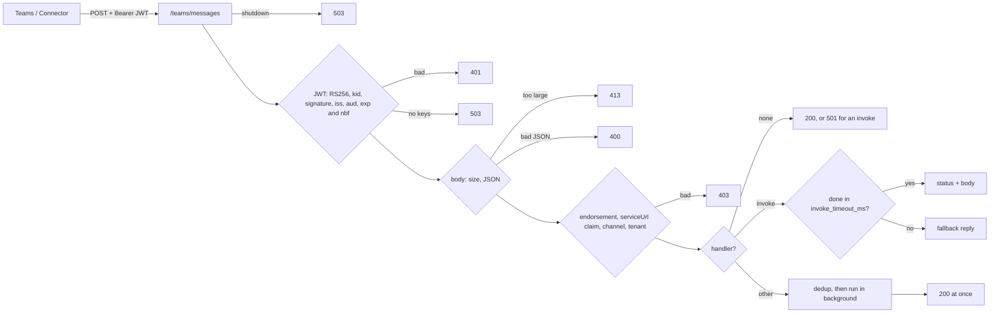

# autumn-plugin-teams

Microsoft Teams plugin for [autumn-web](https://autumn-web.app) 0.8.

- A Bot Framework route. It checks the Connector JWT before it reads the
  body.
- Typed handlers by command, activity type, event name, invoke name, or
  Adaptive Card verb.
- A Connector REST client. It gets an app token and retries safely. It sends
  the token only to allowed hosts. It also sends proactive messages.
- A health indicator, Prometheus metrics, and a drain at shutdown.
- Test helpers: a test JWT authority and a fake transport.

## Install

```toml
[dependencies]
autumn-plugin-teams = "0.1"
```

```rust,ignore
use autumn_plugin_teams::activity::{Activity, InvokeResponse};
use autumn_plugin_teams::{HandlerResult, TeamsContext, TeamsPlugin};

async fn deploy(ctx: TeamsContext, a: Activity) -> HandlerResult<()> {
    let (_, env) = a.command().unwrap_or_default();
    ctx.reply(Activity::message(format!("Deploying {env}"))).await?;
    Ok(())
}

async fn approve(_ctx: TeamsContext, a: Activity) -> HandlerResult<InvokeResponse> {
    let verb = a.card_action().map(|c| c.verb).unwrap_or_default();
    Ok(InvokeResponse::card_message(format!("{verb}: done")))
}

#[autumn_web::main]
async fn main() {
    autumn_web::app()
        .plugin(
            TeamsPlugin::new()
                .command("deploy", deploy)
                .card_action("approve", approve),
        )
        .run()
        .await;
}
```

Set two env vars: `TEAMS_APP_ID` and `TEAMS_APP_PASSWORD`. For a
single-tenant bot, also set `TEAMS_TENANT_ID`. See `examples/app.rs` for
cards, a welcome text, and a proactive message.

## Azure Bot setup

Set the **Messaging endpoint** of the Azure Bot to
`https://<host>/teams/messages`. `/teams` is the default base path.

To change the base path, use `TeamsPlugin::new().base_path("/bots/teams")`.
This is a builder setting, because autumn mounts routes before it loads
config.

### CSRF

The Connector sends no CSRF token. The JWT check protects the route. If CSRF
protection is on, exempt the base path:

```toml
[security.csrf]
exempt_paths = ["/teams"]
```

The plugin cannot add this exemption. If it is missing, the app stops at
start. The error message shows the fix. CAPTCHA checks only form bodies. The
Connector sends JSON, so CAPTCHA needs no change.

### Process roles

The route serves only in the `web` and combined roles. A `worker` process
needs no app ID check and no exemption. It still gets the client, so a
`#[job]` can send proactive messages.

## JWT check



| Step | Rule | Failure |
|---|---|---|
| Header | `Authorization: Bearer <JWT>`, 16 KiB or less | 401 |
| Algorithm | RS256 only | 401 |
| Key | `kid` in the Bot Framework key set (`openid_metadata_url` → `jwks_uri`), and a valid signature | 401 |
| Claims | `iss` in `issuers`, `aud` = app ID, `exp` and `nbf` with `clock_skew_secs` (300) | 401 |
| Keys | No key set can be loaded | 503 |
| Body | `max_body_bytes` or less, valid activity JSON | 413, 400 |
| Endorsement | The key endorses the activity `channelId` | 403 |
| `serviceUrl` | The `serviceurl` claim equals the activity `serviceUrl` | 403 |
| Allowlists | `channelId` in `allowed_channels`, tenant in `allowed_tenants` (if set) | 403 |

Key set rules:

- The plugin refreshes the key set after `keys.cache_secs` (24 h at most).
  During the refresh, a known `kid` still works. The request does not wait.
- An unknown `kid` refreshes the key set at most once per
  `keys.min_refresh_secs` (default 60 s).
- After a failed refresh, the old keys stay in use for up to 5 days. The
  next try waits `keys.min_refresh_secs`. After 5 days, the route replies
  503.

A valid JWT is valid for its life plus the skew. The JWT does not cover the
body. So `allowed_tenants` is as strong as the JWT check, and no stronger.

## Handlers

| Builder call | Activity | Handler returns | Ack |
|---|---|---|---|
| `command(word, h)` | `message` whose first word is `word` | `()` | At once. |
| `on_message(h)` | other `message` (also a card `Action.Submit`) | `()` | At once. |
| `on_message_update(h)` | `messageUpdate` (a user edited a message) | `()` | At once. |
| `on_message_delete(h)` | `messageDelete` (a user deleted a message) | `()` | At once. |
| `on_members_added(h)` | `conversationUpdate` with `membersAdded` | `()` | At once. |
| `on_members_removed(h)` | `conversationUpdate` with `membersRemoved` | `()` | At once. |
| `on_conversation_update(h)` | each `conversationUpdate` | `()` | At once. |
| `on_reaction(h)` | `messageReaction` | `()` | At once. |
| `on_installation_update(h)` | `installationUpdate` | `()` | At once. |
| `on_event(name, h)` | `event` with this `name` | `()` | At once. |
| `card_action(verb, h)` | `adaptiveCard/action` invoke with this verb | `InvokeResponse` | Waits up to `invoke_timeout_ms`. |
| `invoke(name, h)` | other invoke with this `name` | `InvokeResponse` | Waits up to `invoke_timeout_ms`. |

A handler is `async fn(TeamsContext, Activity) -> HandlerResult<T>`.
`TeamsContext` gives `reply`, `send`, `typing`, `update`, `delete`, the
client, the app state, and the `ConversationReference`.

A command match ignores the mention of the bot, a leading `/`, and case.
Other mentions stay in the text. `Activity::command()` gives the word and the
rest of the text. `Activity::is_card_submit()` finds a card `Action.Submit`.

### Invokes

Teams waits 5 s for an invoke reply. The plugin waits `invoke_timeout_ms`
(default 4000, max 4500). If the handler is slower, the plugin sends a
fallback reply. The handler continues, but Teams does not get its reply. For
slow work, reply at once and send a proactive message later.

| Case | `card_action` (Universal Actions) | Other invokes |
|---|---|---|
| No handler | 200, error body with `statusCode` 400 | 501 |
| Handler error or panic | 200, error body with `statusCode` 500 | 500, empty body |
| Handler too slow | 200, error body with `statusCode` 500 | 200, empty body |

Universal Actions need HTTP 200. The error goes in the body
(`application/vnd.microsoft.error`), with `error_text` as the message. Teams
never gets error details.

Invokes have no dedup. Teams sends an invoke again only when it got no
reply, and it needs a reply each time.

### Errors

A handler error or panic does not stop the app. For a message or a command,
the user gets `error_text` as a reply.

### Delivery

The plugin drops a repeat activity ID in the same conversation for
`dedup_window_secs` (default 1 h). The dedup check runs in the background
task, so the ack does not wait for it. If the store fails, or takes more than
2 s, the handler runs: delivery is at least once.

The default store is in memory, for one process. For many replicas, use a
shared store:

```rust,ignore
use autumn_web::webhook::{RedisWebhookReplayStore, WebhookReplayRedisConfig};

TeamsPlugin::new().with_replay_store(Arc::new(RedisWebhookReplayStore::from_config(&redis)?))
```

A restart stops background handlers. Use a `#[job]` for work that must
continue after a restart.

## Connector client

```rust,ignore
let client = TeamsClient::from_state(&state).expect("teams plugin installed");
client.send_to(&stored_reference, &Activity::message("Build done")).await?;
```

| Method | Connector call |
|---|---|
| `send_to_conversation` | `POST /v3/conversations/{id}/activities` |
| `reply_to_activity` | `POST /v3/conversations/{id}/activities/{activityId}` |
| `update_activity` | `PUT /v3/conversations/{id}/activities/{activityId}` |
| `delete_activity` | `DELETE /v3/conversations/{id}/activities/{activityId}` |
| `create_conversation` | `POST /v3/conversations` |
| `all_members`, `get_paged_members` | `GET /v3/conversations/{id}/pagedmembers` (page size 50 to 500) |
| `get_member` | `GET /v3/conversations/{id}/members/{memberId}` |
| `get_members` | `GET /v3/conversations/{id}/members`. Use it for chats only. Microsoft throttles it for teams. |
| `team_details`, `team_channels` | `GET /v3/teams/{teamId}[/conversations]` |
| `send_to` | a proactive message to a stored `ConversationReference` |
| `call` | any other operation |

App token:

- The client gets the app token with client credentials from
  `{login_base_url}{tenant}/oauth2/v2.0/token`. The tenant is
  `botframework.com` for a multi-tenant bot.
- The cache keeps the token until 5 min before it expires. For a token that
  lives less than 10 min, the margin is half its life.
- One token request runs at a time. Callers that wait share its result.
- While a refresh runs, the old token serves if it is not expired.

Retry rules:

- **401:** the client gets a new token and tries again one time. This needs
  `api.max_attempts` of 2 or more.
- **429 and 412:** the client waits for `Retry-After` (1 s if it is not set)
  and tries again. If `Retry-After` is more than `api.max_wait_ms`, the call
  stops with `RateLimited`.
- **5xx and network errors:** the client tries again with backoff only for
  GET, PUT, and DELETE. It never repeats a POST: a send can post two times.
  Microsoft also asks to retry 502 and 504. For a POST, the plugin does not.

`serviceUrl` rules: the client sends the token only to an HTTPS URL whose
host is in `service_url_hosts` (default `smba.trafficmanager.net`). The URL
must not have user info, a port, a query, or a fragment. Plain HTTP is
allowed only on a loopback host, for tests.

## Config

All keys are optional. Defaults:

```toml
[teams]
app_id_env = "TEAMS_APP_ID"
app_password_env = "TEAMS_APP_PASSWORD"
tenant_id_env = "TEAMS_TENANT_ID"
login_base_url = "https://login.microsoftonline.com/"
oauth_scope = "https://api.botframework.com/.default"
openid_metadata_url = "https://login.botframework.com/v1/.well-known/openidconfiguration"
issuers = ["https://api.botframework.com"]
clock_skew_secs = 300
service_url_hosts = ["smba.trafficmanager.net"]
allowed_channels = ["msteams"]
allowed_tenants = []
invoke_timeout_ms = 4000
max_body_bytes = 1048576      # 4 MiB at most
dedup_window_secs = 3600
drain_timeout_secs = 10
error_text = "Sorry, that did not work. Try again later."

[teams.keys]
cache_secs = 86400
min_refresh_secs = 60

[teams.api]
max_attempts = 3
initial_backoff_ms = 500      # 60000 at most
max_wait_ms = 30000           # 60000 at most
timeout_ms = 10000

[teams.health]
cache_secs = 30
```

The plugin reads `[teams]` from `autumn.toml`, then from the profile file
(`autumn-prod.toml`), then from env vars such as
`AUTUMN_TEAMS__INVOKE_TIMEOUT_MS=3000`. Put a comma between list items in an
env var. The config never holds secrets. It holds the names of the env vars
that hold them. Builder calls (`with_app_id`, `with_app_password`,
`with_tenant_id`) override the env vars.

### Government clouds

| Cloud | `service_url_hosts` | Other settings |
|---|---|---|
| GCC | `smba.infra.gcc.teams.microsoft.com` | No change. |
| GCC High | `smba.infra.gov.teams.microsoft.us` | Set `login_base_url`, `oauth_scope`, `openid_metadata_url`, and `issuers` for GCC High. |
| DoD | `smba.infra.dod.teams.microsoft.us` | Set `login_base_url`, `oauth_scope`, `openid_metadata_url`, and `issuers` for DoD. |

## Operations

- **Health:** `teams` in `/actuator/health`. The status is `Up` when the bot
  gets an app token. It is `Down` when the token request fails, with a short
  error code. It is `Unknown` before start or with no password.
  `TeamsPlugin::readiness(true)` adds it to `/ready`. A health timeout does
  not stop the token request.
- **Metrics:** on `/actuator/prometheus`: `teams_requests_total{outcome}`,
  `teams_handler_runs_total{kind,outcome}`, `teams_late_acks_total`,
  `teams_api_calls_total{operation,outcome}`,
  `teams_api_retries_total{operation}`, `teams_token_requests_total{outcome}`,
  `teams_key_refreshes_total{outcome}`, `teams_handlers_in_flight`. Label
  values come from fixed sets in code, never from activity data.
- **Shutdown:** the route replies 503, so the Connector can send the activity
  again. The plugin waits for handlers up to `drain_timeout_secs`.

## Tests for apps

Enable the `testing` feature in `dev-dependencies`:

```toml
[dev-dependencies]
autumn-plugin-teams = { version = "0.1", features = ["testing"] }
```

```rust,ignore
use autumn_plugin_teams::testing::{self, TestAuthority};
use autumn_plugin_teams::transport::MemoryTransport;
use autumn_plugin_teams::{TeamsConfig, TeamsPlugin};
use autumn_web::reexports::chrono::Utc;

let authority = TestAuthority::new(testing::APP_ID);
let transport = MemoryTransport::new();
let plugin = TeamsPlugin::with_config(TeamsConfig::default())
    .with_app_id(testing::APP_ID)
    .with_app_password("test")
    .with_key_source(authority.key_source())
    .with_transport(transport.clone())
    .command("deploy", deploy);
let client = autumn_web::test::TestApp::new().plugin(plugin).build();
let activity = testing::message("deploy prod");
let now = u64::try_from(Utc::now().timestamp()).unwrap();
client
    .post("/teams/messages")
    .header("authorization", &authority.bearer(&activity, now))
    .body(serde_json::to_string(&activity).unwrap())
    .send()
    .await
    .assert_status(200);
// The handler runs in the background. Then `transport.requests()` holds
// the replies that it sent.
```

Never trust the test key in production. Anyone can sign with it.

## Not in scope

User SSO and OAuth cards. Managed identity and certificate credentials.
Microsoft Graph calls. File consent cards. Meeting events. Streaming
replies. An Adaptive Card builder. A limit on concurrent handlers. The Bot
Framework Emulator JWT path.

## License

Apache-2.0.
