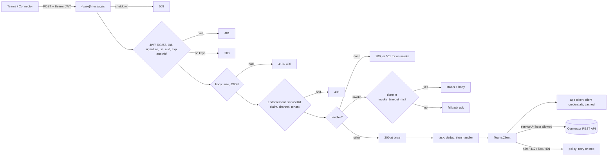

# Plan: `autumn-plugin-teams`

Style: ASD-STE100. Short sentences. Active voice.

## 1. Problem

Development groups build a Microsoft Teams bot in the same app as their web
site.
A Teams bot gets activities from the Bot Framework Connector as HTTP `POST`
requests with a signed JWT. The bot replies through the Connector REST API.
autumn-web 0.8 has no Bot Framework token check, no Connector client, and no
activity routing. This plugin adds them with no upstream change.

No GitHub issue exists for this work. Section 8 gives the acceptance criteria.

## 2. Autumn footprint (sources)

| Autumn feature | Doc or source | Plugin use |
|---|---|---|
| `Plugin` trait, `PluginContract` | `extensibility`, `plugin.rs` | `TeamsPlugin` is a one-line install for autumn-web 0.8. |
| `plugin_conformance` | `plugin_conformance.rs` | Tests run the harness on the plugin route. |
| `Route`, `AppBuilder::routes` | `route.rs`, `app.rs` | Mount `POST {base}/messages`. It shows in `autumn routes`. |
| `config_section` | `app.rs` | Accept `[teams]` in strict config. |
| `state_initializer`, `on_startup`, `on_shutdown` | `app.rs` | Start before job workers. Report a start error. Drain at shutdown. |
| `HealthIndicator`, `MetricsSource` | `health-indicators`, `metrics-sources` | Health from a token request. Counters on `/actuator/prometheus`. |
| `WebhookReplayStore` | `webhook.rs` | Drop a repeat activity. Memory or Redis. |
| `ClockSource` | `time.rs` | Token time checks use the autumn clock. Tests use `FixedClock`. |
| `security.csrf` | `security/config.rs` | A plugin cannot add an exemption. Startup fails with the fix text. |
| OIDC `jsonwebtoken` 11 (`rust_crypto`) | `auth.rs` | Same crate and backend. The autumn OIDC check is private and needs other claims, so the plugin has its own check. See ADR 0001. |
| `http_client::Client` | `http_client.rs` | Not used. The retry rule depends on the Connector operation. See ADR 0002. |

## 3. Brainstorming (use cases)

1. **Messages.** Run a handler for a message. Route the first word to a command handler (`deploy`). Strip the bot mention.
2. **Conversation events.** Members added and removed (welcome text). Reactions. App install and uninstall. Named `event` activities.
3. **Invokes.** Adaptive Card Universal Actions (`adaptiveCard/action`) by verb. Task modules, message extensions, and other invokes by name. Reply in the HTTP body.
4. **Connector client.** Send, reply, update, delete. Typing. Create a 1:1 conversation. Members (paged and all), one member. Team details and channels.
5. **Proactive messages.** Store a `ConversationReference`. Send to it later from a `#[job]`.
6. **Outbound auth.** Client credentials for single-tenant and multi-tenant bots. Cache the token.
7. **Operations.** Health indicator, Prometheus metrics, drain on shutdown.
8. **Tests for apps.** A test token authority. A fake transport. No network.
9. **Later (not in scope):** user SSO and OAuth cards, managed identity and certificate credentials, Microsoft Graph calls, file consent, meeting events, streaming replies, Teams AI library features, an Adaptive Card builder.

Selected scope: items 1 to 8.

## 4. Reverse brainstorming (how to make it fail)

| How to fail | Counter-measure |
|---|---|
| Accept a forged activity. | Check the JWT before any parse of the body: `Bearer` scheme, RS256 only, key from the Bot Framework JWKS, issuer, audience = app ID. |
| Accept an expired or future token. | Check `exp` and `nbf` with 5 min skew. Proven in the spec. |
| Accept a token from a key that is not for Teams. | Require the key endorsement for the activity `channelId`. 403 if missing. |
| Use a valid token for a different `serviceUrl`. Send the bot token to an attacker. | Require the `serviceUrl` claim to equal the activity `serviceUrl`. Send the bot token only to HTTPS hosts in `service_url_hosts`. |
| Accept `alg: none` or HS256 with the public key. | Allow RS256 only. Ignore the token header algorithm list. |
| An attacker sends many unknown `kid` values. The bot refreshes keys for each. | Refresh keys on an unknown `kid` at most once per `keys.min_refresh_secs`. Proven in the spec (for a clock that does not go back). |
| Stale keys after a Microsoft key rotation. | Refresh the key set every 24 h or sooner. After a failed refresh, old keys serve until they are 5 days old. |
| A key refresh blocks all requests. | A known `kid` serves from the old set while one background task refreshes. |
| A tenant that is not ours uses the bot. | Optional `allowed_tenants`. 403 for another tenant. |
| Miss the 5 s invoke limit. Teams retries two times and shows an error. | Reply to an invoke in `invoke_timeout_ms` (default 4 s, max 4.5 s). Then reply 200 empty. Run other activities after a 200 ack. |
| Run a handler twice on a retry. | Drop a repeat activity ID per conversation with the replay store. Reply 200. |
| Retry a send after a 5xx. Post two times. | Retry 5xx and network errors only for GET, PUT, and DELETE. Retry 429 for all. Proven in the spec. |
| Wait forever on a large `Retry-After`. | Cap the wait. Give up above the cap. Proven in the spec. |
| A token expires during a call. | Refresh before expiry with a margin. On a 401 from the Connector, get a new token and retry one time. Proven in the spec. |
| Many token requests at once at expiry. | Single flight: one request at a time. Others wait for it. |
| A handler panic stops the process. | Catch the panic. Count it. An invoke gets 500 with no detail. |
| CSRF blocks every Teams request in production. | Check at startup. Fail with the exact config fix. |
| A large body uses too much memory. | Read at most `max_body_bytes`. Reply 413. |
| Leak the app password or a token. | Read the password from a named env var. Never log it. Redact `Debug`. |
| Unbounded metric labels. | Labels come from fixed sets in code. Never activity data. |
| Shutdown drops in-flight handlers. | Track tasks. Reply 503 after shutdown starts. Wait up to `drain_timeout_secs`. |
| Tests need Microsoft. | `HttpTransport` trait with `MemoryTransport`. A `TestAuthority` signs tokens with a test key. |

## 5. Six thinking hats

- **White (facts):** The Connector sends `Authorization: Bearer <JWT>`. Issuer `https://api.botframework.com`. Audience is the app ID. Keys come from `https://login.botframework.com/v1/.well-known/openidconfiguration` → `jwks_uri`. Each key has `endorsements` (channel IDs). The token has a `serviceUrl` claim. Clock skew is 5 min. Refresh keys at least every 24 h. The bot gets a token with client credentials from `https://login.microsoftonline.com/{tenant}/oauth2/v2.0/token`, scope `https://api.botframework.com/.default`. The tenant is `botframework.com` for a multi-tenant bot. Teams waits 5 s for an invoke reply, then retries two times. Rate limits give 429. The Connector gives `ErrorResponse { error: { code, message } }` for 4xx and 5xx.
- **Red (feelings):** Users want `.command("deploy", handler)` and `.card_action("approve", handler)` and nothing more. A 403 from CSRF with no help text confuses the user. Users fear that a bot accepts forged messages.
- **Black (risks):** autumn applies CSRF to plugin routes. A plugin cannot add an exemption. The route path must be a builder setting: autumn mounts routes before it loads config. Background handlers are not durable. Microsoft does not let you make new multi-tenant bots. Single-tenant bots must work. A stored `ConversationReference` holds a `serviceUrl`. The host allowlist must apply to it too.
- **Yellow (benefits):** One install gives verified, routed, typed Teams handlers and a client. No Bot Framework SDK. Proactive messages work from `#[job]`.
- **Green (ideas):** Upstream seam: let a plugin add CSRF exemptions in `build()`. A shared Bot Framework core for other channels later. An Adaptive Card builder crate later.
- **Blue (process):** Write the Verus spec for the policy. Write failing tests. Implement. Refactor. Review with agents from several angles. Check each AC.

## 6. Design

Modules:

- `policy` — pure functions. Token time window, token refresh, key refresh, retry decision, backoff. Verified core.
- `auth` — inbound JWT check. `KeySource` trait, OpenID key source, key cache.
- `token` — outbound client-credentials token. Cache and single flight.
- `config` — `[teams]` config. Layered TOML and env. Validation.
- `transport` — `HttpTransport` trait, `ReqwestTransport`, `MemoryTransport`.
- `client` — `TeamsClient`. Connector REST API calls.
- `activity` — typed activities, accounts, references, invoke replies.
- `handlers` — handler types, registry, and task runner.
- `engine` — request processing: verify, parse, check, dedup, dispatch, ack.
- `routes` — the autumn `Route`.
- `health`, `metrics` — health indicator and metrics source.
- `plugin` — `TeamsPlugin`, `TeamsRuntime`.
- `testing` — `TestAuthority` (feature `testing`).

## 7. Delivery semantics

- The plugin drops a repeat activity ID inside `dedup_window_secs`.
- A handler runs after the ack. The Connector does not retry a failed handler.
- Background handlers are not durable. Enqueue a `#[job]` for work that must survive a restart.
- An invoke reply that comes after `invoke_timeout_ms` is lost. For slow work, reply at once and send a proactive message later.

## 8. Acceptance criteria

- **AC1** `TeamsPlugin` implements `autumn_web::plugin::Plugin`. One call installs it. It declares a contract for autumn-web 0.8 and the `[teams]` config section. It passes the autumn conformance harness.
- **AC2** The JWT check runs before the plugin reads the body. A missing or bad JWT gives 401. No handler runs before the check. The check:
  - `Bearer` scheme, 16 KiB or less.
  - RS256 only.
  - A key from the Bot Framework `OpenID` key set, by `kid`, and a valid signature.
  - `iss` in `issuers`, `aud` = app ID.
  - `exp` and `nbf` with `clock_skew_secs` (default 300).
- **AC3** After the parse, three checks give 403 on failure:
  - The key endorsement holds the activity `channelId`, and the channel is in `allowed_channels`.
  - The `serviceurl` claim equals the activity `serviceUrl`.
  - The tenant is in `allowed_tenants` (when set).
- **AC4** Keys: the plugin refreshes the key set after `keys.cache_secs` (max 24 h). During the refresh, a known `kid` still serves. An unknown `kid` refreshes the set at most once per `keys.min_refresh_secs`. After a failed refresh, the old keys serve until they are 5 days old, counted from the last good refresh.
- **AC5** Activities: `message` goes to a command handler by first word (bot mention removed, case-insensitive), else to `on_message`. `conversationUpdate` goes to `on_members_added`, `on_members_removed`, and `on_conversation_update`. Also `messageUpdate`, `messageDelete`, `messageReaction`, `installationUpdate`, and `event` by name. The 200 ack does not wait for the handler. A repeat activity ID per conversation is dropped. Unknown types get 200.
- **AC6** Invokes: `adaptiveCard/action` goes to a handler by verb, other invokes by name. The handler reply is the HTTP reply when it comes in `invoke_timeout_ms`. A slower handler gives a fallback ack and counts a late ack. A Universal Action ack is always HTTP 200; a failure is an error body (400 for no handler, 500 for an error, a panic, or a late reply). Another invoke gives 501 with no handler, and 500 with an empty body for an error or a panic.
- **AC7** `TeamsClient` has typed calls: send, reply, update, delete, create conversation, members, paged members (page size 50 to 500), all members (pagination), one member, team details, team channels, and send to a `ConversationReference`. A Connector error gives a typed error with the code. A `TeamsContext` can reply, send, type, update, and delete in the current conversation.
- **AC8** App token: client credentials to the tenant token endpoint (`botframework.com` for multi-tenant). The cache keeps the app token until a margin before it expires (5 min, or half the life of a short token). One token request runs at a time, and waiters share its result. The old token serves during a refresh. A 401 from the Connector gets a new token and one retry.
- **AC9** Retry: 429 and 412 wait for `Retry-After` and retry. A wait over `api.max_wait_ms` stops the call. 5xx and network errors retry with backoff only for GET, PUT, and DELETE. Attempts are bounded.
- **AC10** The client sends the app token only to an HTTPS URL whose host is in `service_url_hosts` (default `smba.trafficmanager.net`), with no user info, no port, no query, and no fragment. Plain HTTP only on a loopback host, for tests.
- **AC11** Handler errors and panics do not crash the app. At shutdown, the route acks with 503 and waits for handlers up to `drain_timeout_secs`.
- **AC12** A health indicator (app token request, cached, single flight, opt-in readiness). A metrics source with request, handler, API, token, and key counters. Label values come from fixed sets in code.
- **AC13** Serde config with validation, layered TOML, `AUTUMN_TEAMS__*` env vars, and secrets from named env vars. Startup fails when the app ID or password is missing in a web role, or when CSRF blocks the route.
- **AC14** `testing::TestAuthority` (feature `testing`) and `MemoryTransport` are public for app tests.
- **AC15** `cargo fmt`, clippy pedantic and nursery are clean. No `unwrap` in production code. Unit, property, and integration tests pass. Coverage is 85% or more. CI runs these.
- **AC16** Verus specs state the policy invariants, including a model of the whole retry loop. Proofs pass in CI. A test fails when `src/policy.rs` drifts from the spec.
- **AC17** README, CLAUDE.md, CHANGELOG, ADRs, an example app, and Mermaid diagrams. All docs use ASD-STE100.

## 9. Review

See `docs/ac-evidence.md` for the review rounds, findings, and fixes.

## 10. Out of scope

User SSO and OAuth cards. Managed identity and certificate credentials. Microsoft Graph. File consent cards. Meeting events. Streaming replies. A limit on concurrent handlers. An Adaptive Card builder. A Bot Framework Emulator token path.
